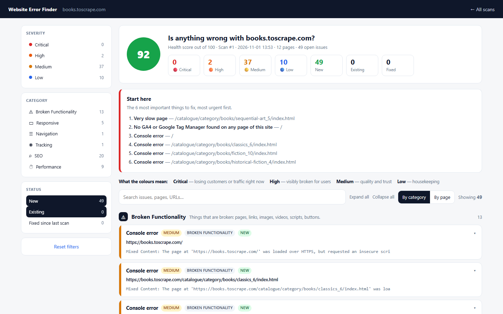

# website-error-finder

Give it a URL. It crawls the site, opens pages in a real browser at desktop, tablet and mobile sizes, and reports everything broken, inconsistent or slow, ranked by severity with a recommended fix.



*Scan report for books.toscrape.com*

## Why it exists

Manual site QA misses things and takes hours. Marketing teams usually find a dead booking link only after the campaign has spent money on it.

## How it works

- Crawls the domain and its subdomains
- Tests links, forms, buttons, tracking, SEO tags, responsive layout and page speed
- Attaches a screenshot to every finding
- Compares each scan with the last one, so you see new, existing and fixed issues
- Optional email alerts

## Run it

```bash
pip install -r requirements.txt
python -m playwright install chromium
python scan.py https://books.toscrape.com --max-pages 12
python app.py   # dashboard at http://127.0.0.1:8030
```

## Notes

The screenshot is a real scan of books.toscrape.com, a public site built for scraping practice.

## Stack

Python, Playwright, FastAPI, SQLite

Built by [Vinay Kumar](https://vinaykumar.work) with Claude Code. I set the design and rules and reviewed the output.
